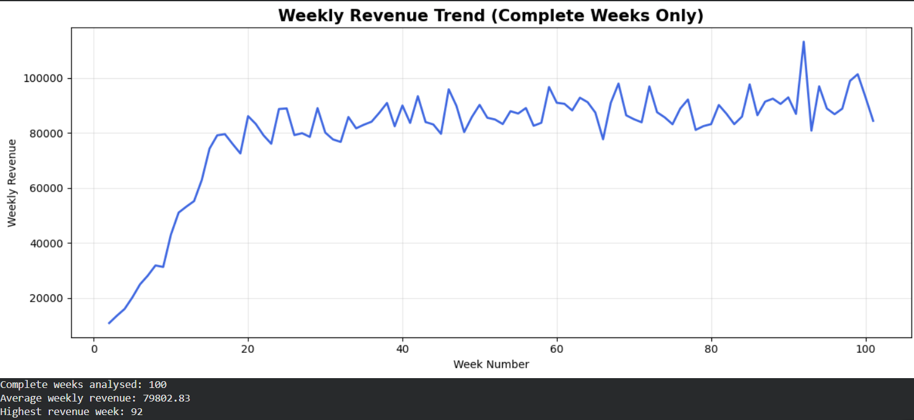
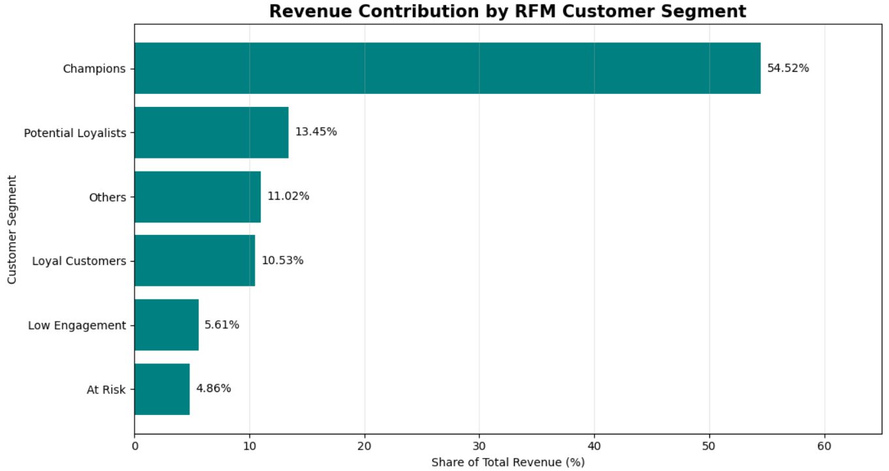

# Customer Sales & Behavioral Analysis

### Python | Exploratory Data Analysis | Retail Analytics | RFM Customer Segmentation

An end-to-end Python data analytics project exploring customer purchasing behavior, sales trends, product performance, and RFM-based customer segmentation using the **dunnhumby Complete Journey dataset**.

The project analyzes approximately **2.6 million retail transaction records across 2,500 households**, covering 102 observation weeks. It combines data quality assessment, exploratory analysis, customer segmentation, and sensitivity analysis to identify purchasing patterns and develop data-driven business recommendations.

## Project Objectives

- Analyze overall sales performance and weekly revenue trends.
- Understand shopping basket values and customer purchasing patterns.
- Identify revenue-driving departments and product categories.
- Examine customer revenue concentration.
- Segment households using Recency, Frequency, and Monetary (RFM) analysis.
- Evaluate the impact of gasoline and miscellaneous transactions on customer metrics.
- Translate analytical findings into actionable business recommendations.

## Tech Stack

| Category | Tools & Techniques |
|---|---|
| Programming Language | Python |
| Data Manipulation | Pandas, NumPy |
| Data Visualization | Matplotlib |
| Development Environment | Google Colab |
| Analytics Techniques | Data Cleaning, EDA, RFM Segmentation, Quantile Analysis, Sensitivity Analysis |
| Version Control | GitHub |

## Dataset

**Source:** dunnhumby — The Complete Journey

The dataset contains retail purchasing information, including transaction records, product details, household demographics, and promotional data.

### Dataset Overview

| Metric | Value |
|---|---:|
| Original Transaction Records | 2,595,732 |
| Records Used for Revenue Analysis | 2,576,882 |
| Unique Households | 2,500 |
| Positive-Sales Shopping Baskets | 275,542 |
| Observation Period | 102 Weeks |
| Households with Demographic Information | 801 |

**Data Preparation:** The analysis excludes 18,850 zero-sales transaction rows, joins transactions with product information, and validates record counts and revenue totals.

Demographic information is available for approximately 32% of households and was not used to make population-wide conclusions.

The raw dataset is not included in this repository.

## Project Workflow

### 1. Data Understanding and Quality Assessment

Performed an initial assessment of the source datasets to examine:

- Dataset structures, missing values, and duplicate records.
- Zero-sales transactions and unusual quantities.
- Product identifier consistency.
- Household and shopping basket relationships.
- Missing product attributes and demographic coverage.

### 2. Data Cleaning and Preparation

- Excluded 18,850 zero-sales rows from revenue analysis.
- Merged transaction records with product information.
- Validated transaction counts and revenue totals.
- Prepared household-level and basket-level analytical datasets.
- Created a retail-focused comparison dataset excluding selected gasoline and miscellaneous transactions.

### 3. Exploratory Data Analysis

Analyzed:

- Overall revenue and shopping basket KPIs.
- Weekly revenue trends.
- Shopping basket value distribution.
- Customer purchasing frequency.
- Customer revenue concentration.
- Department and product-category performance.

The first and final observation weeks were excluded from complete-week revenue comparisons because they contained fewer than seven days.

### 4. RFM Customer Segmentation

Calculated three household-level metrics:

| Metric | Definition |
|---|---|
| Recency | Days since the household's most recent recorded purchase |
| Frequency | Number of unique shopping baskets |
| Monetary | Total recorded sales value generated by the household |

Recency scores were assigned using predefined day ranges, while Frequency and Monetary scores were calculated using quantile-based ranking.

Households were classified into six rule-based segments:

- Champions
- Loyal Customers
- Potential Loyalists
- At Risk
- Low Engagement
- Others

### 5. Sensitivity Analysis

Created an alternative retail-focused dataset by excluding the following departments:

- `KIOSK-GAS`
- `MISC SALES TRAN`
- `MISC. TRANS.`

Recalculated household-level RFM measures and segment assignments to examine how these exclusions influenced customer metrics and classifications.

---

## Key Findings & Visualizations

### 1. Sales Performance

| KPI | Result |
|---|---:|
| Total Recorded Revenue | 8,057,463.08 |
| Total Shopping Baskets | 275,542 |
| Unique Households | 2,500 |
| Average Basket Value | 29.24 |
| Median Basket Value | 17.18 |
| Average Weekly Revenue (100 Complete Weeks) | 79,802.83 |
| Highest Revenue Week | Week 92 |
| Revenue in Week 92 | 113,192.87 |

*Revenue figures are reported in dataset sales-value units; no currency is assumed.*

**Key Insight:** The average basket value (29.24) is considerably higher than the median (17.18), indicating a right-skewed distribution. A relatively small number of high-value shopping baskets increase the overall average, making the median a useful complementary measure of typical basket spending.

Weekly revenue fluctuates throughout the observation period, with Week 92 recording the highest complete-week revenue of 113,192.87.

#### Weekly Revenue Trend



### 2. Customer Revenue Concentration

Customer spending is unevenly distributed across households.

| Customer Group | Share of Total Revenue |
|---|---:|
| Top 10% of Households | 34.29% |
| Top 20% of Households | 53.05% |

**Key Insight:** Just 20% of households contribute more than half of total recorded revenue.

This indicates substantial revenue concentration among higher-spending households, making customer concentration an important consideration when evaluating retention and revenue strategies.

### 3. Department Performance

The highest-revenue departments included:

| Department | Revenue Contribution |
|---|---:|
| Grocery | 50.81% |
| Drug GM | 13.10% |
| Produce | 6.92% |
| Meat | 6.81% |
| KIOSK-GAS | 6.75% |

**Key Insight:** Grocery generates approximately half of recorded sales, while Drug GM represents the second-largest department.

However, gasoline and miscellaneous transactions also contribute to recorded revenue. Their inclusion can influence how conventional retail purchasing behavior is interpreted.

This motivated the sensitivity analysis performed later in the project.

### 4. RFM Customer Segmentation

The RFM analysis classified all 2,500 households into six behavioral segments.

| Customer Segment | Households | Customer Share | Revenue Share |
|---|---:|---:|---:|
| Champions | 623 | 24.92% | 54.52% |
| Potential Loyalists | 494 | 19.76% | 13.45% |
| Others | 361 | 14.44% | 11.02% |
| Loyal Customers | 248 | 9.92% | 10.53% |
| Low Engagement | 695 | 27.80% | 5.61% |
| At Risk | 79 | 3.16% | 4.86% |

#### RFM Segment Revenue Contribution



**Key Observations:**

- Champions represent 24.92% of households and contribute 54.52% of recorded revenue.
- Champions and Loyal Customers collectively account for 34.84% of households but generate 65.05% of historical revenue.
- Low Engagement households represent 27.80% of customers but contribute only 5.61% of revenue.
- At Risk households represent 3.16% of customers and contribute 4.86% of historical revenue.

**Interpretation:** Monetary value is one of the inputs used to construct RFM segments. Therefore, higher historical revenue among high-scoring segments is partly expected by construction.

These results describe historical customer behavior rather than independently demonstrating predictive power or future customer retention.

### 5. Sensitivity Analysis: Retail-Focused Transactions

To examine the influence of nonstandard retail categories, selected gasoline and miscellaneous transactions were excluded and the RFM analysis was repeated.

| Metric | Full Dataset | Retail-Focused Dataset |
|---|---:|---:|
| Recorded Revenue | 8,057,463.08 | 7,382,602.07 |
| Shopping Baskets | 275,542 | 251,071 |
| Households | 2,500 | 2,500 |

The exclusions removed **674,861.01 in recorded revenue**, equivalent to approximately **8.38%** of the original total.

#### Changes in Household-Level Metrics

| Measure | Households Affected | Percentage |
|---|---:|---:|
| Recency | 106 | 4.24% |
| Frequency | 1,489 | 59.56% |
| Monetary | 1,981 | 79.24% |
| Final RFM Segment | 176 | 7.04% |

**Key Insight:** Although Monetary and Frequency changed for many households, only 176 households (7.04%) moved to a different RFM segment under this particular exclusion scenario.

The remaining **92.96% retained their original segment classifications**.

This is a descriptive sensitivity result rather than proof of statistical robustness. No random-removal baseline or bootstrap comparison was performed.

---

## Business Recommendations

The following recommendations are based on observed purchasing patterns and represent hypotheses for further testing.

### 1. Prioritize High-Value Customer Engagement

Champions and Loyal Customers collectively represent 34.84% of households but account for 65.05% of historical revenue.

**Recommendation:** Evaluate personalized loyalty benefits and retention initiatives for these households, measuring incremental revenue and campaign costs rather than assuming that high historical spending guarantees future purchases.

### 2. Develop Potential Loyalists

Potential Loyalists represent 19.76% of households and contribute 13.45% of recorded revenue.

**Recommendation:** Test personalized product recommendations and repeat-purchase incentives to determine whether additional engagement increases purchasing activity.

### 3. Investigate At Risk Customers

At Risk households represent 3.16% of customers but account for 4.86% of historical revenue.

**Recommendation:** Investigate reduced recent purchasing activity and test selective re-engagement campaigns. Because this is a relatively small segment, interventions should be evaluated against their costs and potential returns.

### 4. Monitor Basket Value Distribution

Average basket value (29.24) is considerably higher than median basket value (17.18).

**Recommendation:** Track both average and median basket values when evaluating purchasing behavior, as the average alone may overstate typical basket spending.

### 5. Separate Nonstandard Retail Transactions

Gasoline and miscellaneous exclusions reduced recorded revenue by 8.38% and changed RFM classifications for 7.04% of households.

**Recommendation:** Consider reporting conventional retail purchasing behavior separately from nonstandard transaction categories when comparing customer spending and segmentation results.

---

## Repository Structure

```text
customer-sales-behavior-analysis/
├── README.md
├── customer_sales_behavior_analysis.ipynb
├── weekly_revenue_trend.png
└── rfm_segment_revenue_contribution.png
```

## How to Run the Project

1. Obtain the **dunnhumby Complete Journey** dataset.
2. Extract the source CSV files.
3. Create a folder named `data` in Google Drive and upload the CSV files.
4. Open `customer_sales_behavior_analysis.ipynb` in Google Colab.
5. Mount Google Drive and verify that the notebook's data path matches the uploaded folder.
6. Run the notebook cells sequentially.

The notebook uses source files including `transaction_data.csv`, `product.csv`, and other tables from the Complete Journey dataset.

## Limitations

- The dataset records relative days and weeks rather than calendar dates.
- The first and final observation weeks are incomplete.
- Zero-sales transaction rows were excluded from revenue analysis.
- Recorded sales values are not necessarily equivalent to customers' out-of-pocket expenditure.
- Household demographic information is available for only 801 of 2,500 households.
- RFM segments are rule-based and depend on the selected scoring thresholds.
- Revenue differences between RFM segments are partly expected because Monetary is a segmentation input.
- The sensitivity analysis evaluates a specific exclusion scenario without a statistical benchmark.
- No predictive model, causal inference, or experimental campaign validation was performed.

## Conclusion

This project demonstrates an end-to-end Python analytics workflow involving data quality assessment, data preparation, exploratory analysis, customer segmentation, and sensitivity testing.

The analysis identifies uneven customer spending, revenue concentration, department-level differences, and distinct historical RFM profiles.

The sensitivity analysis further illustrates how transaction-category decisions can influence customer metrics and segmentation outcomes.

Overall, the project demonstrates how descriptive retail analytics can transform large transactional datasets into interpretable findings and testable business recommendations.
